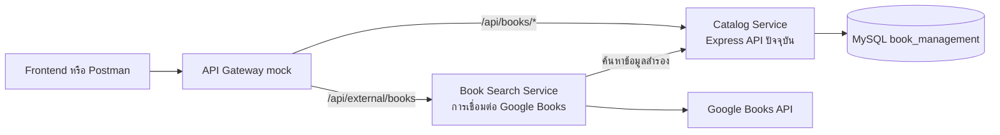

# Lab 13 — การออกแบบ Microservices

## โครงงาน
ระบบจัดการหนังสือ (Book Management System)

## 1. สถานะปัจจุบัน
แอปพลิเคชัน Phase 2 เป็น Express application เดียวที่ทำงานบนพอร์ต 3000 ภายในมีทั้ง endpoint สำหรับ CRUD หนังสือ การค้นหาหนังสือในฐานข้อมูล และการเชื่อมต่อ Google Books ส่วน `src/services/external-api.js` เป็นโมดูลที่จัดการการเรียก Google Books พร้อมกลไก retry และ timeout แต่ปัจจุบันยังเป็นเพียงโมดูลในแอปเดียว ไม่ใช่ microservice ที่รันแยกต่างหาก

## 2. การแบ่งขอบเขตของ Service ที่เสนอ

| Service | หน้าที่รับผิดชอบ | Endpoint หรือโค้ดที่มีอยู่ |
|---|---|---|
| Catalog Service | จัดการหนังสือ ผู้เขียน หมวดหมู่ สมาชิก และการยืมคืน | routes ของ `/api/books`, `/api/authors`, `/api/categories`, `/api/members`, `/api/borrowings` ใน `src/index.js` |
| Book Search Service | ค้นหาหนังสือจาก Google Books พร้อมจัดการ retry/timeout และใช้ Catalog Service เป็นแหล่งข้อมูลสำรองเมื่อบริการภายนอกใช้ไม่ได้ | `GET /api/external/books` ใน `src/services/book-search-server.js`; retry/timeout ใน `src/services/external-api.js` |
| API Gateway (mock) | เป็นทางเข้าจุดเดียวสำหรับ client และส่งคำขอไปยัง service ที่เกี่ยวข้อง | เส้นทางที่เสนอ: `/api/books/*` ส่งไป Catalog Service และ `/api/external/books` ส่งไป Book Search Service |

## 3. ลำดับการส่งคำขอ

## 4. แผนการทำ Lab 13

1. คง API จาก Phase 2 ไว้เป็น Catalog Service โดยรักษาการทำงาน CRUD เดิม
2. แยกการทำงานค้นหาหนังสือภายนอกให้เรียกผ่าน Book Search Service ซึ่งมี URL/พอร์ตของตัวเอง และคงกลไก timeout/retry ไว้
3. เมื่อ Google Books ใช้งานไม่ได้ ให้ Book Search Service เรียก endpoint ค้นหาของ Catalog Service เพื่อหาข้อมูลสำรอง แทนการเข้าถึงตารางฐานข้อมูลของ Catalog Service โดยตรง
4. เพิ่ม API Gateway mock เพื่อส่งต่อคำขอไปยัง Catalog Service และ Book Search Service โดยให้ client เรียกผ่าน Gateway
5. สาธิตคำขอที่สำเร็จผ่าน Gateway อย่างน้อยหนึ่งกรณี และสาธิตกรณีบริการปลายทางขัดข้องพร้อมการใช้ข้อมูลสำรอง
6. ปรับเอกสาร OpenAPI ให้ตรงกับ URL ของ Gateway และรูปแบบคำตอบของแต่ละ service

## 5. ขอบเขตความรับผิดชอบและข้อจำกัด

- Catalog Service เป็นเจ้าของข้อมูลหนังสือและคำสั่ง SQL ที่เกี่ยวข้อง
- Book Search Service เป็นเจ้าของการเชื่อมต่อผู้ให้บริการภายนอกและกลไกรับมือเมื่อเกิดข้อผิดพลาด
- Book Search Service ควรใช้ API ของ Catalog Service เพื่อค้นหาข้อมูลสำรอง วิธีนี้ช่วยให้คำสั่ง SQL ของแค็ตตาล็อกอยู่ภายใน Catalog Service
- สำหรับโครงงานรายวิชานี้ Gateway เป็น mock เพื่อสาธิตการกำหนดเส้นทางและการเรียก HTTP ระหว่าง service การออกแบบนี้ไม่ได้หมายความว่าเป็นระบบ production หรือมีฐานข้อมูลแยกอิสระครบถ้วนแล้ว

## 6. Checklist ตรวจรับงาน

- [x] Catalog Service และ Book Search Service มี listener/พอร์ตแยกกัน (3000/3101)
- [x] Gateway มี URL สำหรับ client จุดเดียว (3200) และส่งคำขอไปยังทั้งสอง service ได้
- [x] มี automated test ตรวจการส่งต่อไปยัง Catalog และ Book Search ผ่าน Gateway
- [x] Book Search Service ใช้ Catalog API สำหรับ fallback
- [x] OpenAPI และ Postman Collection ใช้ Gateway port 3200 และครอบคลุม route ปัจจุบัน

ก่อนนำเสนอให้รัน smoke test ผ่าน Gateway และตรวจการเปลี่ยน stock ใน MySQL จริงตามขั้นตอนใน `README.md`.
